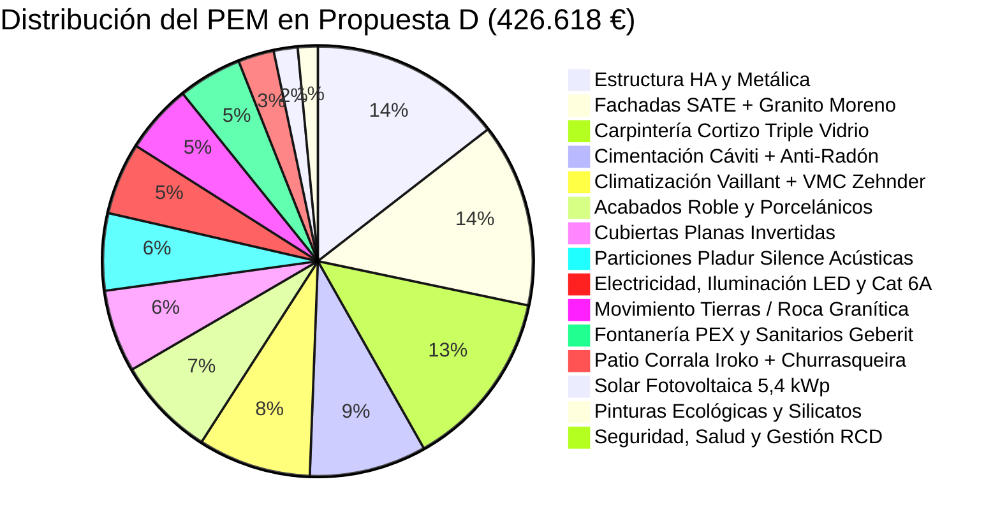
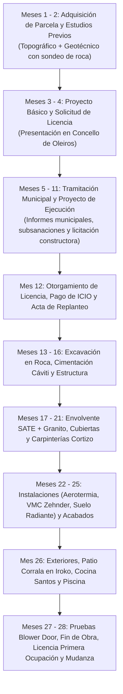

# Presupuesto Realista Integral de Autopromoción — Hogar Oleiros
## Construcción desde Cero: Parcela, Obra Passivhaus, Técnicos, Tasas e Impuestos

> **Documento Técnico de Valoración Económica — Proyecto de Ejecución**  
> **Ubicación:** Liáns / Santa Cruz, Concello de Oleiros (A Coruña)  
> **Régimen:** Autopromoción de vivienda habitual unifamiliar aislada (PXOM Oleiros — Ordenanza 2B)  
> **Superficie Construida Cerrada:** 215,00 m² (PB: 116,50 m² + P1: 98,50 m²)  
> **Superficies Exteriores Cubiertas:** 53,50 m² (Porche Sur 36 m², Balcón Sur P1 14 m², Porche Norte 3,5 m²)  
> **Superficie Construida Equivalente (Contrata y Tasación):** **241,75 m²** (215 m² + 50 % de exteriores cubiertos)  
> **Parcela Tipo:** 600 m² en suelo urbano consolidado  

---

## 1. Tabla Resumen Comparativa: Los 3 Escenarios de Inversión Llave en Mano

| Capítulo / Partida Presupuestaria | 1. Estándar / Funcional | 2. Calidad Media-Alta | 3. Propuesta D Consolidada (Passivhaus Premium) | Régimen Fiscal / Observaciones |
| :--- | :---: | :---: | :---: | :--- |
| **A. Terreno e Impuestos de Adquisición** | **156.650,00 €** | **178.650,00 €** | **195.150,00 €** | Parcela ~600 m² en Liáns/Santa Cruz + ITP Galicia (10%) + Notaría/Registro/Tasación |
| 1. Compraventa de Parcela Neta | 140.000,00 € | 160.000,00 € | 175.000,00 € | Solar urbano consolidado con acometidas a pie de finca |
| 2. ITP Galicia (10 %) + Notaría + Registro + Tasación | 16.650,00 € | 18.650,00 € | 20.150,00 € | Gastos notariales, registrales e impuesto autonómico |
| **B. Estudios Previos del Terreno** | **2.480,50 €** | **2.480,50 €** | **2.843,50 €** | Con IVA 21 % |
| 1. Levantamiento Topográfico Georreferenciado | 750,00 € | 750,00 € | 750,00 € | Coordenadas UTM ETRS89 oficiales para Concello |
| 2. Estudio Geotécnico con sondeo de roca granítica | 1.300,00 € | 1.300,00 € | 1.600,00 € | Clave en Oleiros (bolas de granito sano y nivel freático) |
| 3. IVA Estudios Previos (21 %) | 430,50 € | 430,50 € | 493,50 € | IVA servicios técnicos |
| **C. Ejecución de Obra (Contrata Constructora)** | **427.487,50 €** | **543.015,00 €** | **641.492,50 €** | Base imponible obras + IVA 10 % |
| 1. PEM Edificación (Materiales + Mano de Obra) | 304.726,89 € | 365.672,27 € | 426.617,65 € | Coste de ejecución material puro de la vivienda |
| 2. Gastos Generales (13 %) + Beneficio Industrial (6 %) | 57.898,11 € | 69.477,73 € | 81.057,35 € | Margen normativo y operativo de la constructora (19 %) |
| *(Subtotal Contrata Vivienda y Porches)* | *(362.625,00 €)* | *(435.150,00 €)* | *(507.675,00 €)* | *(241,75 m² equiv. a 1.500 / 1.800 / 2.100 €/m²)* |
| 3. Cierres de Parcela y Urbanización Exterior | 12.000,00 € | 16.500,00 € | 21.000,00 € | Muro zócalo granito + lamas lacadas + cancela auto + césped/riego |
| 4. Cocina Completa Amueblada y Equipada | 14.000,00 € | 20.000,00 € | 28.000,00 € | Santos Fine + isla Dekton Kelya + Bora Pure + Bosch Serie 8 |
| 5. Piscina Salina (7,5 × 3,5 m) y Solárium | 0,00 € | 22.000,00 € | 26.500,00 € | Vaso gunitado, gres porcelánico C3, clorador salino y LED |
| *(Base Imponible Total Contratas)* | *(388.625,00 €)* | *(493.650,00 €)* | *(583.175,00 €)* | *Facturación neta constructora y gremios* |
| 6. IVA Reducido de Autopromoción (10 %) | 38.862,50 € | 49.365,00 € | 58.317,50 € | Aplicable por Ley del IVA a vivienda habitual autopromotor |
| **D. Honorarios Facultativos y Control de Calidad** | **40.743,95 €** | **52.542,98 €** | **63.235,85 €** | Con IVA 21 % |
| 1. Arquitecto: Proyecto Básico + Ejecución + DO | 21.330,88 € | 27.425,42 € | 33.062,87 € | ~7,0 % – 7,75 % sobre PEM |
| 2. Aparejador: Dirección de Ejecución (DEO) + CSS | 9.141,81 € | 12.798,53 € | 15.998,16 € | ~3,0 % – 3,75 % sobre PEM |
| 3. Laboratorio Ensayos Hormigón/Acero + Test Blower Door | 3.200,00 € | 3.200,00 € | 3.200,00 € | Certificación estanqueidad al aire $n_{50} < 1,0\text{ h}^{-1}$ |
| 4. IVA Honorarios Técnicos (21 %) | 7.071,26 € | 9.119,03 € | 10.974,82 € | IVA general servicios profesionales |
| **E. Tasas y Licencias Municipales (Concello de Oleiros)** | **16.150,53 €** | **19.380,63 €** | **22.610,74 €** | Tasas tributarias no recuperables |
| 1. ICIO (Impuesto Construcciones, Instalaciones y Obras) | 12.189,08 € | 14.626,89 € | 17.064,71 € | 4,00 % sobre PEM municipal oficial |
| 2. Tasa Urbanística por tramitación de Licencia de Obras | 3.961,45 € | 4.753,74 € | 5.546,03 € | ~1,30 % sobre PEM oficial |
| *(Fianza Residuos RCD y Reposición Aceras - Reembolsable)* | *(4.000,00 €)* | *(4.000,00 €)* | *(4.000,00 €)* | *(Depósito de fianza devuelto íntegramente al fin de obra)* |
| **F. Acometidas Definitivas de Suministros** | **5.445,00 €** | **5.445,00 €** | **5.445,00 €** | Con IVA 21 % |
| 1. Electricidad (UFD Distribución) + Inspección | 1.800,00 € | 1.800,00 € | 1.800,00 € | Enganche y acometida subterránea |
| 2. Agua Potable y Red de Saneamiento (Concello Oleiros) | 2.200,00 € | 2.200,00 € | 2.200,00 € | Arquetas, contadores y canon de enganche |
| 3. Telecomunicaciones (Canalización y arqueta fibra óptica) | 500,00 € | 500,00 € | 500,00 € | Conexión a red general subterránea |
| 4. IVA Acometidas de Servicios (21 %) | 945,00 € | 945,00 € | 945,00 € | IVA servicios de suministro |
| **G. Gastos Notariales, Registrales y AJD Obra Nueva** | **10.629,38 €** | **12.204,75 €** | **13.547,62 €** | Formalización legal y registral |
| 1. Notaría y Registro (Declaración de Obra Nueva en constr.) | 1.500,00 € | 1.500,00 € | 1.500,00 € | Escritura pública y asiento registral |
| 2. AJD Galicia (Actos Jurídicos Documentados) | 5.829,38 € | 7.404,75 € | 8.747,62 € | 1,50 % sobre el valor real declarado de contrata |
| 3. Notaría y Registro (Acta de Fin de Obra) | 1.500,00 € | 1.500,00 € | 1.500,00 € | Cierre registral de la edificación |
| 4. Gestoría y Tasaciones intermedias para banco | 1.800,00 € | 1.800,00 € | 1.800,00 € | Certificaciones de tasación mensual para disposición hipoteca |
| **H. Colchón de Contingencias e Imprevistos** | **19.431,25 €** | **34.555,50 €** | **46.654,00 €** | 5 % (Estándar), 7 % (Media) y 8 % (Premium) |
| Contingencia picado de roca granítica en Oleiros + desvíos | 19.431,25 € | 34.555,50 € | 46.654,00 € | Fondo de seguridad obligatorio para no paralizar la obra |
| **TOTAL INVERSIÓN LLAVE EN MANO (€)** | **679.018,10 €** | **848.274,36 €** | **990.979,21 €** | **Coste real global de inicio a fin (IVA e impuestos incluidos)** |

> [!NOTE]
> **Variante Propuesta D en Dos Fases:** Si se difiere la ejecución material de la piscina salina y solárium a una segunda fase (dejando ejecutadas las arquetas y preinstalaciones subterráneas), el desembolso inicial de la Propuesta D se reduce a **~961.800 €**.

---

## 2. Desglose del PEM por Capítulos Constructivos (Propuesta D Consolidada)

Base del **Presupuesto de Ejecución Material (PEM puro): 426.617,65 €** (equivalente a 507.675 € de contrata con el 19 % de GG+BI):

### Tabla de Mediciones y Capítulos Normalizados:
1. **Capítulo 01 — Actuaciones Previas y Movimiento de Tierras (5,2 % · 22.184 €):**
   * Desbroce de parcela de 600 m², vaciado, cajeado para solera y aceras perimetrales.
   * Partida de picador neumático para bolos de granito sano y xabre superficial frecuentes en Oleiros.
2. **Capítulo 02 — Cimentación y Solera Sanitaria Cáviti Anti-Radón (8,8 % · 37.542 €):**
   * Zapatas aisladas y vigas riostras en hormigón armado HA-25/B/20/IIa y acero B 500 S.
   * Sistema Cáviti de 50 cm con ventilación cruzada natural mediante tubos perimetrales.
   * Lámina elastomérica anti-radón continua con solapes termosoldados (cumplimiento CTE DB-HS6, zona II Oleiros).
3. **Capítulo 03 — Estructura Portante (14,5 % · 61.860 €):**
   * Pilares de hormigón armado $25\times 25\text{ cm}$, forjado unidireccional de bovedilla de hormigón y losas macizas de voladizos en porche Sur y balcón P1.
   * Zancas metálicas ocultas HEA 160 empotradas en muro para peldaños volados de roble macizo.
4. **Capítulo 04 — Fachadas y Envolvente Térmica (13,8 % · 58.873 €):**
   * Hoja exterior de termoarcilla rectificada / bloque cerámico de 19 cm.
   * Sistema SATE con 12 cm de EPS grafito blanco ($U = 0,22\text{ W/m}^2\text{K}$).
   * Zócalo y paños nobles en mampostería / aplacado de granito moreno gallego de 12 cm con anclajes de acero inoxidable AISI 316.
5. **Capítulo 05 — Cubiertas Planas Invertidas y Balcón Sur (6,2 % · 26.450 €):**
   * Formación de pendientes con mortero celular, doble lámina bituminosa SBS soldada al fuego.
   * Aislamiento térmico XPS de 14 cm, geotextil antipunzonante y protección pesada de grava blanca lavada.
   * Pavimento flotante exterior sobre plots en balcón P1.
6. **Capítulo 06 — Carpintería Exterior Cortizo de Alta Eficiencia (13,5 % · 57.593 €):**
   * Correderas elevables minimalistas de gran formato *Cortizo Cor Vision Plus* enrasadas a cota cero en Salón (5,00 m), Comedor (3,50 m) y Cocina a Patio (3,00 m).
   * Ventanas y balconeras oscilobatientes *Cortizo COR 80 Industrial RPT*.
   * Triple acristalamiento acústico y control solar *Guardian Sun* ($U_g = 0,6\text{ W/m}^2\text{K}$, $R_w = 42\text{ dB}$).
7. **Capítulo 07 — Particiones Interiores y Confort Acústico (5,8 % · 24.744 €):**
   * Tabiquería seca *Pladur Silence* doble placa a cada cara ($15+15\text{ mm}$) con subestructura de 70 mm rellena de lana de roca de alta densidad ($R_w \ge 50\text{ dB}$).
   * Puertas de paso macizas lacadas en blanco con juntas perimetrales isofónicas y picaportes magnéticos.
8. **Capítulo 08 — Revestimientos y Pavimentos Interiores (7,5 % · 31.996 €):**
   * Pavimento general de tarima flotante multicapa de roble natural de 14 mm apta para suelo radiante.
   * Suelos y alicatados en gres porcelánico rectificado de gran formato en baños, zaguán y lavandería.
   * Falsos techos continuos de yeso laminado hidrófugo con foseados perimetrales para iluminación indirecta LED.
9. **Capítulo 09 — Fontanería, Saneamiento y Sanitarios (4,8 % · 20.478 €):**
   * Red interior en tubería multicapa PEX-a con aislamiento térmico y colectores zonificados.
   * Bajantes insonorizadas *Geberit Silent-PP* revestidas con lana de roca.
   * Sanitarios suspendidos con cisterna empotrada *Geberit Duofix*, griferías monomando termostáticas empotradas en negro mate y platos de ducha a cota cero.
10. **Capítulo 10 — Climatización y Calidad del Aire (8,5 % · 36.262 €):**
    * Bomba de calor aerotérmica bibloc *Vaillant aroTHERM plus* de alta eficiencia (gas R290).
    * Suelo radiante-refrescante por agua a baja temperatura en toda la vivienda con termostatos táctiles independientes por estancia.
    * Sistema de ventilación mecánica controlada (VMC) de doble flujo *Zehnder ComfoAir Q350* con recuperación entálpica del 92 %, filtros F7/G4 y red de conductos *ComfoTube*.
11. **Capítulo 11 — Electricidad, Iluminación LED y Red Cat 6A (5,4 % · 23.037 €):**
    * Instalación eléctrica completa de grado elevado según REBT con protecciones contra sobretensiones.
    * Mecanismos de diseño *Schneider Elegance* en blanco polar.
    * Iluminación 100 % LED integrada cálida (2700K) regulable.
    * Red estructurada de voz y datos con cableado Cat 6A blindado (10 Gbps) hacia rack central en cuarto técnico.
12. **Capítulo 12 — Energía Solar Fotovoltaica (1,8 % · 7.679 €):**
    * 12 módulos monocristalinos monocristalinos de 450 Wp (**5,4 kWp**) en cubierta técnica.
    * Inversor híbrido de 5 kW preparado para conexión de baterías de litio y vertido a red con compensación de excedentes.
13. **Capítulo 13 — Patio Corrala Central y Porche Sur (2,7 % · 11.519 €):**
    * Pavimento de tarima maciza de madera de Iroko con grapas ocultas de acero inoxidable AISI 316 a cota cero.
    * Canaleta de drenaje perimetral oculta de ranura continua en inox AISI 316.
    * Alcorque central con grava volcánica y arce japonés (*Acer palmatum*).
    * Barbacoa gallega tradicional de obra (*churrasqueira*) de mampostería de granito, campana de forja y bancada de granito Zimbabwe.
14. **Capítulo 14 — Pinturas y Tratamientos Ecológicos (1,5 % · 6.399 €):**
    * Pinturas al silicato de poro abierto, libres de compuestos orgánicos volátiles (COVs), transpirables y lavables.
    * Lasures al agua hidrófugos de alta durabilidad en maderas exteriores de aleros y celosías.
15. **Capítulo 15 — Seguridad, Salud y Gestión Ambiental de Residuos (1,0 % · 4.266 €):**
    * Protecciones colectivas de obra (redes perimetrales, barandillas provisionales, líneas de vida).
    * Plan de gestión de residuos de construcción y demolición (RCD) con transporte a vertedero homologado de la comarca.

---

## 3. Cronograma Real de Autopromoción en Oleiros (28 Meses)

El Concello de Oleiros destaca por su solvencia urbanística y la gran calidad de sus servicios públicos, pero sus plazos de concesión de licencias de obra mayor son garantistas y rigurosos (habitualmente entre 6 y 9 meses de tramitación técnica):

---

## 4. Estructura de Financiación y Liquidez Familiar

Tomando como base los datos económicos de la unidad familiar (Propuesta D Consolidada con inversión de **990.979 €**):

* **Recursos Propios Brutos Disponibles:**
  * Liquidez en cuentas bancarias: `306.000 €`
  * Venta completada de segunda residencia: `162.000 €`
  * **Total liquidez bruta:** **`468.000 €`**
* **Fondos de Seguridad Reservados (Intocables):**
  * Colchón familiar para imprevistos domésticos: `58.000 €`
  * **Aportación Neta de Fondos Propios a la Operación:** **`410.000 €`**
* **Necesidad de Financiación Hipotecaria (Hipoteca de Autopromoción):**
  * Importe de préstamo hipotecario requerido: **`580.000 €`**
  * **Valor de Tasación Final Estimado de la Vivienda Terminada:** `1.150.000 € – 1.250.000 €` (debido al alto valor de mercado residencial en Liáns/Santa Cruz y la calificación energética A / Passivhaus).
  * **Loan-to-Value (LTV) Bancario Real:** **`~48 % – 50 %`** sobre tasación final, lo que sitúa la operación en el tramo de menor riesgo bancario y permite acceder a los diferenciales de interés más competitivos del mercado hipotecario.
* **Mecánica de Disposición del Préstamo:**
  1. *Fase 1 (Suelo):* Adquisición de la parcela y pago de impuestos íntegramente con fondos propios (`195.150 €`).
  2. *Fase 2 (Técnicos y Licencia):* Proyectos, estudios, tasas de Oleiros y acometidas con fondos propios (`~94.000 €`).
  3. *Fase 3 (Construcción):* Activación de la hipoteca de autopromoción con disposiciones mensuales contra certificaciones de obra emitidas por el Aparejador y visadas por la tasadora bancaria.
