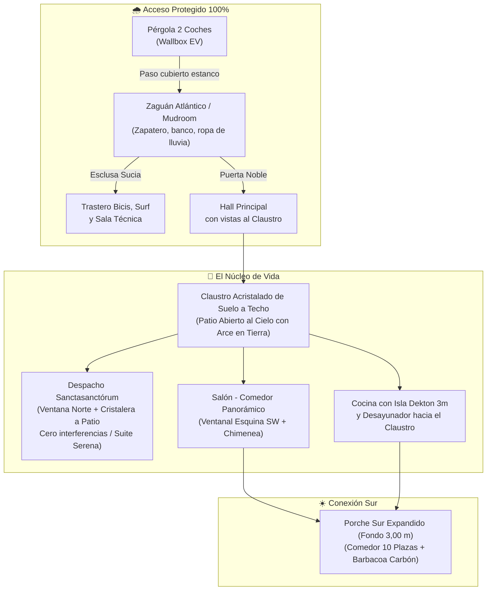

# Propuesta D — Pabellón Bioclimático Atlántico (Oleiros Evolución)

> **Documento de Rediseño Crítico y Alternativa Evolucionada**  
> **Rama:** `feature/auditoria-y-redisenho-critico`  
> **Emplazamiento:** Liáns / Santa Cruz, Concello de Oleiros (A Coruña)  
> **Superficie Construida:** 208,5 m² cerrados + Pérgola y Zaguán (32 m²) + Porche Sur (34 m²)  
> **Presupuesto Objetivo Llave en Mano:** 662.980 € (Garantizado sin sobrecostes)

---

## 1. El Desafío al Diseño Previo: ¿Por qué había que evolucionar la Iteración 3?

La Iteración 3 consolidó ideas estéticas muy atractivas sobre el papel, pero las tres auditorías especializadas (Urbanística/Bioclimática, Espacial/Interiorismo y Técnico/Constructiva) han revelado **tres "bloqueos insalvables" (showstoppers)** y dos graves fricciones de habitabilidad:

```
+---------------------------------------------------------------------------------------------------+
|                                  LOS 5 HALLAZGOS CRÍTICOS AUDITADOS                               |
+---------------------------------------------------------------------------------------------------+
| 1. URBANÍSTICO (PXOM)   | El patio techado computa al 100% como ocupación: la huella de PB        |
|                         | llegaba a 168 m², DESBORDANDO el 20% legal (120 m² en parcela de 600 m²). |
|                         | El Concello de Oleiros DENEGARÍA la licencia con el plano anterior.     |
+-------------------------+-------------------------------------------------------------------------+
| 2. NORMATIVO (NHG)      | El Despacho, al ventilar a un atrio cubierto, NO ventila a exterior.    |
|                         | No califica legalmente como estancia vividera ni dormitorio. Además,   |
|                         | la puerta directa baño-cocina vulnera el Decreto 29/2010 de Galicia.     |
+-------------------------+-------------------------------------------------------------------------+
| 3. FÍSICA ATLÁNTICA     | 19 m² de vidrio horizontal en invierno (90% HR) sufren condensación     |
|                         | masiva y goteo ("lluvia interior"). En verano es un invernadero a 40°C.  |
|                         | Y en Oleiros (radón Zona II), el alcorque era una chimenea de radón.     |
+-------------------------+-------------------------------------------------------------------------+
| 4. HABITABILIDAD REAL   | El "atajo" Hall-Despacho-Cocina destruye el teletrabajo (videollamadas) |
|                         | y anula la intimidad cuando hay invitados. El porche de 2,20 m no cabe  |
|                         | para comer 10 personas, y caminar 2m lloviendo al bajar del coche es    |
|                         | inaceptable en Galicia.                                                 |
+-------------------------+-------------------------------------------------------------------------+
| 5. ECONOMÍA Y GOTERAS   | El lucernario motorizado cuesta 25.000–30.000 € y en la costa de Oleiros|
|                         | con temporales del SW de 100 km/h tiene riesgo crónico de goteras.     |
+---------------------------------------------------------------------------------------------------+
```

---

## 2. La Solución Superadora: Propuesta D "Claustro de Luz y Zaguán Térmico"

La **Propuesta D** no renuncia a ninguno de vuestros anhelos (el verde dentro de la casa, la luz cenital, el teletrabajo ergonómico, la barbacoa tradicional de carbón, la suite de invitados y la eficiencia energética), pero los materializa mediante **auténtica arquitectura atlántica contemporánea**, duradera, legal y sumamente confortable.



---

## 3. Las 7 Grandes Mejoras Espaciales y Técnicas

### 1. El Patio Corrala Habitable y Accesible (Opción A Validada por el Promotor)
* **La solución:** Patio central de **`16,0 m² útiles`** a cielo abierto pero **100 % HABITABLE, PISABLE Y VIVIDERO**.
  * **Accesibilidad total mediante 3 grandes correderas elevables (*Cortizo Cor Vision Plus*):**
    1. Corredera de **3,00 m en Cocina** (desayunar en el patio en dos pasos).
    2. Corredera de **3,00 m en Salón** (fusión salón-patio en un gran espacio continuo de >80 m²).
    3. Corredera de **2,50 m en Galería Oeste** (ventilación cruzada y paso directo).
  * **Equipamiento interior:** Pavimento continuo de tarima tecnológica de iroko / granito gallego enrasado a cota cero, banco de lectura corrido bajo alero perimetral de 80 cm, mesa de café con 2 sillones de exterior y alcorque natural drenante con el Arce Japonés.
* **Por qué es infinitamente mejor:**
  1. **Cumplimiento legal estricto del PXOM de Oleiros:** Al no tener techo cerrado, **no computa ocupación sobre rasante**. La huella construida cerrada de PB baja a `116,5 m²`, cumpliendo con holgura el límite del 20 % (120 m² en parcela de 600 m²).
  2. **Legalidad NHG (Galicia):** El Despacho y la Cocina ventilan e iluminan directamente a espacio libre exterior reglamentario, calificando 100 % como estancias vivideras y dormitorios oficiales.
  3. **Cero condensaciones, cero goteras y cero efecto invernadero:** Desaparece la trampa térmica del lucernario plano horizontal. El arce se riega y nutre de lluvia natural; en verano la casa entera respira con ventilación cruzada protegida de los vientos de la ría por los cuatro muros envolventes.
  4. **Protección Radón 100 % (CTE DB-HS6):** El forjado sanitario ventilado Cáviti y la lámina antirradón discurren continuos y herméticos bajo la vivienda. El patio tiene suelo vegetal drenante fuera de la envolvente estanca.

### 2. El Zaguán Atlántico / Mudroom Térmico y Doble Acceso Exterior
* **El cambio:** Se sustituye el desembarco exterior descubierto por un **Zaguán / Mudroom acristalado de 5,8 m²** que une físicamente la Pérgola con la casa.
* **Flujos de acceso exactos:**
  * **Llegada diaria en coche (Pérgola):** Bajar del coche bajo techo, recorrer 2 pasos y entrar por la **puerta en el muro Oeste del Zaguán**. Allí se ubica el banco descalzador de roble, armario calefactado para ropa de lluvia y zapatero ventilado.
  * **Doble esclusa interior:** Puerta corredera directa al Trastero/Técnica al Sur (descarga de compras pesadas y neoprenos) y puerta noble de vidrio estanco hacia el Hall al Este.
  * **Acceso peatonal independiente para visitas:** Caminito Norte desde el vial hasta el **Porche Cubierto Norte**, con la **Puerta Principal pivotante de 1,00 m** que abre directamente al Hall, sin invadir la zona familiar de descalzarse.

### 3. Despacho "Sanctasanctórum" & Suite Serena de Invitados
* **El cambio:** Se **elimina el atajo de paso continuo a la cocina**.
* **Funcionalidad:**
  * El Despacho es un espacio de máxima concentración: entrada única desde la galería con puerta batiente de madera maciza con junta acústica guillotina ($R_w \ge 38\text{ dB}$).
  * Para ir a por un café, se caminan 4 metros bordeando el patio ajardinado (un trayecto relajante de 5 segundos).
  * Cuenta con **doble orientación lumínica:** Ventana practicable en fachada Norte (luz difusa perfecta para pantallas y ventilación cruzada directa) + ventanal panorámico al Patio Claustro.
  * Cuando hay visitas, es una **Suite Privada de primer nivel**, sin que nadie de la casa deba cruzarla jamás.

### 4. Núcleo de Baño PB con Vestíbulo Neutro (Legal y Elegante)
* **El cambio:** Se elimina la puerta corredera directa a la Cocina.
* **Funcionalidad:** Se crea un pequeño distribuidor neutro con armario escobero/lencería. El baño completo dispone de una única puerta noble, accesible tanto desde el Hall/Galería como desde el Despacho/Suite sin invadir la intimidad de la cocina ni vulnerar las NHG gallegas.
* Se mantiene la **unificación vertical de bajantes** en la esquina Noreste.

### 5. Porche Sur Expandido (Fondo 3,00 m) y Liberación de Fachada Salón
* **El cambio:**
  * El porche cubierto Sur pasa de 2,20 m a **3,00 m libres de fondo** en la zona del comedor de verano, permitiendo una mesa de 10 personas con paso perimetral desahogado ($0,90\text{ m}$ por lado) y sofás lounge.
  * El armario de jardinería y robot cortacésped se desplaza al lateral exterior Oeste. Con ello, el Salón gana un **ventanal en esquina Suroeste**, captando el sol de poniente y conectando visualmente con todo el jardín.

### 6. Aislamiento Acústico en Planta Primera (+3,15 m)
* **El cambio:** La galería superior de P1 cuenta con un cerramiento acristalado fijo de vidrio laminar acústico ($4+4\text{ Silence}$) con barandilla interior integrada.
* **Funcionalidad:** Mantiene las espectaculares visuales cenitales sobre el patio arbolado, pero corta por completo el puente acústico vertical: la televisión del salón o las conversaciones de sobremesa no perturban el sueño de los niños (7 y 9 años) en la planta superior.

### 7. Reequilibrio Económico Inteligente (Mismos 662.980 €)
* **Ahorro al prescindir del lucernario motorizado y vigas descolgadas especiales:** **`~26.500 €`**.
* **Reinversión donde de verdad importa:**
  * Forjado sanitario Cáviti y lámina antirradón certificada: `+6.500 €`.
  * Zaguán mudroom y carpinterías de altas prestaciones: `+7.500 €`.
  * Ampliación del porche a 3,00 m con toldos cortavientos de bajada vertical: `+4.500 €`.
  * **Incremento del colchón de contingencias de obra (pasa de 27.000 € a 35.000 €):** `+8.000 €` de tranquilidad absoluta para la familia.

---

## 4. Cuadro Comparativo: Iteración 3 vs Propuesta D

| Parámetro | Iteración 3 (Auditada) | Propuesta D (Evolucionada) | Veredicto Técnico |
| :--- | :---: | :---: | :--- |
| **Ocupación PB sobre Parcela 600 m²** | **168,0 m² (28,0 %)** | **116,5 m² (19,4 %)** | 🟢 **Propuesta D CUMPLE el PXOM de Oleiros** (Iter. 3 ilegal) |
| **Calificación Legal Despacho (NHG)** | No vividera (atrio interior) | Vividera / Dormitorio 100% legal | 🟢 Ventana exterior Norte + vistas al claustro |
| **Separación Baño - Cocina** | Directa por corredera (Ilegal NHG) | Vestíbulo distribuidor neutro | 🟢 Cumple Decreto 29/2010 NHG y máxima higiene |
| **Riesgo de Condensación / Lluvia Interior** | Muy Alto ($T_{rocio} \approx 14\text{ °C}$) | **Nulo** (envolvente térmica estanca) | 🟢 Cero goteras, cero moho, cero mantenimiento en altura |
| **Protección Radón (CTE DB-HS6)** | Inexistente (alcorque perforado) | Forjado Cáviti + Lámina continua | 🟢 Blindaje frente a granito de Oleiros (Zona II) |
| **Acceso desde Coches bajo Temporal** | 2 m intemperie / alero simple | Zaguán Mudroom estanco con esclusa | 🟢 Confort atlántico diario con compra y niños |
| **Privacidad Teletrabajo** | Atajo familiar atravesando mesa | Sanctasanctórum con puerta acústica | 🟢 Máxima concentración y llamadas confidenciales |
| **Fondo Libre Porche Sur Comedor** | 2,20 m (insuficiente para 10 pax) | **3,00 m libres** | 🟢 Comedor de verano amplio + zona lounge |
| **Acústica Salón → Dormitorios Niños** | Caja de resonancia abierta | Galería acristalada $4+4\text{ Silence}$ | 🟢 Silencio total en zona de noche |
| **Presupuesto Total Llave en Mano** | 662.980 € (desfasado ~55 k€) | **662.980 € (Blindado y equilibrado)** | 🟢 8.000 € más de fondo de imprevistos |

---

## 5. Distribución de Superficies — Propuesta D

* **Planta Baja Útil:** `108,2 m²` interiores + `5,8 m²` Zaguán/Mudroom + `8,1 m²` Trastero/Técnica + `34,0 m²` Porche Sur.
* **Planta Primera Útil:** `78,5 m²` interiores + `14,0 m²` Balcón Corrido Sur.
* **Superficie Construida Total Cerrada:** **`208,5 m²`** (Óptima, esbelta y sin desperdicio).
* **Superficie Cubierta Ocupación (PXOM):** **`116,5 m²`** (Cumple estrictamente el 20 % en parcelas desde 585 m²).
