# Auditoría Técnica de Constructibilidad, Estructuras y Economía de Obra
**Vivienda Unifamiliar en Liáns / Santa Cruz (Concello de Oleiros, A Coruña)**  
**Proyecto:** "Pabellón con Patio Corrala Habitable" (Iteración 3 — 212 m² construidos)  
**Fecha de Auditoría:** Noviembre 2026  
**Rol del Auditor:** Auditor Senior de Construcción, Patología Estructural y Economía de Obra (Área de A Coruña y Rías Altas)  
**Marco Normativo de Referencia:** CTE (DB-SE, DB-HE, DB-HS, DB-HR), Normas do Hábitat Galego (NHG - D. 29/2010), PGOM de Oleiros. Skills de referencia: `presupuesto-mediciones` y `bioclimatica-materiales`.

---

## Resumen Ejecutivo

La presente auditoría técnica independiente analiza la **viabilidad constructiva, los riesgos patológicos y la consistencia presupuestaria** del diseño validado en la Iteración 3 para una vivienda unifamiliar de 212 m² en Oleiros.

Si bien la propuesta arquitectónica y funcional presenta un nivel de confort, ergonomía y zonificación interior de gran calidad, la auditoría detecta **tres puntos críticos de alto riesgo técnico y financiero** que deben corregirse antes de contratar el Proyecto Básico y de Ejecución (PBE):

1. **El Lucernario Motorizado Horizontal de 19 m²:** Constituye una anomalía constructiva para el clima costero atlántico (Zona C1 / exposición eólica Grado IV-V). Con un coste real de suministro e instalación de **22.000 € a 28.000 €**, presenta un riesgo inaceptable de filtraciones crónicas por temporales del Suroeste (>90–100 km/h con lluvia batiente), condensaciones superficiales, acumulación de verdín/polen y un coste recurrente de mantenimiento a cota +6,30 m sin acceso seguro.
2. **Complejidad Estructural de la Doble Altura en U:** La interrupción de forjados en torno al vacío central de 5,10 × 3,70 m obliga a vigas de cuelgue o vigas planas fuertemente armadas con riesgo de flecha diferida sobre las carpinterías minimalistas de aluminio (*Cortizo Cor Vision Plus*), además de un puente térmico lineal perimetral de ~18 metros y un severo problema de reverberación acústica ("efecto campana").
3. **Brecha Presupuestaria Llave en Mano (Presupuesto Cerrado 662.980 €):** El ratio previsto de 1.800 €/m² para la contrata es insuficiente para la suma de calidades Premium prescritas (carpintería minimalista enrasada, Dekton, Santos, VMC Zehnder, suelo radiante, domótica Cat 6A y lucernario motorizado). El coste real de contrata en Oleiros para 2026-2027 se sitúa en **2.050–2.200 €/m²**, lo que generaría un sobrecoste oculto de **50.000 € a 80.000 €** en fase de licitación si no se sustituyen los parches tecnológicos de alto coste por soluciones pasivas de mayor nobleza arquitectónica.

---

## 1. Auditoría del Lucernario Motorizado de 19 m² en Costa Atlántica

```
                      ESQUEMA DE PATOLOGÍA CLIMÁTICA ATLÁNTICA
                      Temporales SW (>90-120 km/h) + Lluvia Batiente
                                        ↓↓↓↓↓↓
   Viento dinámico q_p            ═══════════════════   ← Lucernario retráctil móvil 19 m²
   Succión y sobrepresión         ║ Juntas cepillo/  ║     (Vidrio climalit estructural ~1.400 kg)
        ───────────────►          ║ EPDM móviles     ║  ← Infiltración por empuje horizontal
                                  ═══════════════════
   Puente térmico perimetral  ──► ▒▒▒▒▒▒▒▒▒▒▒▒▒▒▒▒▒▒▒ ← Encuentro forjado P1 / viga metálica
                                  ┌─────────────────┐
   Reverberación acústica         │  PATIO CORRALA  │  ← Efecto campana: ruido lluvia (65-75 dB)
   Lluvia / granizo sobre cristal │   HABITABLE     │    y dispersión de ruidos de cocina a P1
                                  │   (Cota ±0,00)  │  ← Suelo porcelánico enrasado
                                  └─────────────────┘
```

### 1.1. Riesgos Patológicos y Físico-Constructivos

#### A. Estanqueidad al Agua y Permeabilidad al Aire (CTE DB-HS 1 y Normas UNE-EN 12207 / 12208)
* **Condicionante de Oleiros (Zona Liáns / Santa Cruz):** La parcela se ubica a menos de 1,5 km de la línea de costa, en una zona de exposición eólica Grado IV/V. Durante el otoño e invierno atlántico, las ciclogénesis y temporales de componente SW generan rachas de viento sostenido superiores a 80–100 km/h acompañadas de precipitaciones horizontales intensas.
* **Fallo intrínseco de los techos correderos:** Un lucernario motorizado horizontal o con pendiente mínima (< 5°) de 5,10 × 3,70 m no puede sellarse como un muro cortina fijo. Requiere carriles de rodadura, juntas de cepillo y sellos labiales de EPDM flexibles. Ningún sistema móvil comercial de grandes dimensiones garantiza estanqueidad al agua bajo presiones dinámicas de viento superiores a 600 Pa (equivalente a vientos de ~110 km/h con agua batiente).
* **Entrada de agua por sobrepresión y remanso:** Cuando el agua de lluvia impacta a alta velocidad, el viento empuja la lámina de agua hacia las uniones entre hojas correderas y contra los topes de cierre. Al no existir una pendiente pronunciada (> 15°), el agua remansa en los perfiles de drenaje interior, colapsa las canaletas ocultas y desborda hacia el interior del patio corrala, afectando directamente al paramento de yeso y al solado enrasado continuo.

#### B. Colonización Biológica, Salitre Marino y Suciedad
* **Microclima húmedo atlántico (HR > 80 %):** La proximidad a masas forestales (pinares y eucaliptales en el entorno de Liáns) produce una densa lluvia de polen en primavera y restos vegetales en otoño.
* **Aparición de verdín y hongos:** El polen depositado sobre una superficie de vidrio subhorizontal con condensaciones matinales persistentes constituye un sustrato biológico idóneo. En menos de 6 meses sin frotado mecánico manual, el vidrio adquiere una pátina verdosa opaca en perímetros y juntas.
* **Niebla salina y degradación de mecanismos:** La atmósfera marina de Santa Cruz transporta aerosoles salinos. El cloruro sódico se deposita en los rodamientos de acero inoxidable, guías de tracción y sensores meteorológicos. Los sensores ópticos de lluvia se empañan o ensucian con frecuencia, perdiendo calibración y provocando que el techo no cierre a tiempo o sufra atascos mecánicos por corrosión galvánica.

#### C. Seguridad, Mantenimiento y Accesibilidad (RD 1627/1997)
* El lucernario se sitúa a la cota **+6,30 m** sobre el forjado de planta baja. Para limpiar 19 m² de vidrio plano horizontal no basta con una pértiga telescópica: requiere que una persona camine o apoye peso sobre el perímetro de la cubierta.
* En cubiertas planas sin pasarelas técnicas ni barandillas perimetrales permanentes de mantenimiento, esto obliga a instalar una línea de vida homologada fija (EN 795) y contratar empresas de trabajos verticales o limpieza especializada a un coste de **250 € a 400 € por intervención** (mínimo 3 veces al año = ~1.000 €/año en mantenimiento recurrente). Caminar sobre un vidrio estructural húmedo con verdín entraña un riesgo de caída en altura crítico.

### 1.2. Coste Real de Suministro e Instalación (Mercado 2026-2027)

Un lucernario motorizado de 19,0 m² no es una ventana estándar de cubierta (tipo Velux modular), sino un sistema estructural de gran envergadura (similar a techos telescópicos de arquitectura singular):
* Vidrio de seguridad estructural: Triple acristalamiento templado-laminar pisable (8+8 templado con butiral acústico + cámara 16 Argón + 6+6 bajo emisivo con control solar Guardian Sun). Peso específico: ~75 kg/m² → **Peso total del conjunto acristalado: ~1.425 kg**.
* Estructura portante de perfiles de aluminio extrusionado con rotura de puente térmico y tratamiento marino anodizado/lacado Seaside (>80 micras).
* Motorización industrial con correas dentadas de acero, motores síncronos de alto par, cuadro eléctrico con maniobra domótica, sensores de lluvia/viento y Sistema de Alimentación Ininterrumpida (SAI) para cierre automático de emergencia ante caída de suministro eléctrico durante tormentas.
* Medios auxiliares: Autogrúa pluma de gran tonelaje para descarga e izado en parcela de Oleiros, montaje especializado y remates de hojalatería perimetral de zinc/aluminio soldados in situ.

| Partida / Concepto Técnico | Estimación Proyecto Original | Coste Real de Mercado (Oleiros 2026-2027) | Desviación Oculta |
| :--- | :---: | :---: | :---: |
| **Suministro del techo móvil motorizado (19 m²)** | ~8.000 € *(diluido en PEM)* | 18.500 € – 22.000 € | +12.000 € |
| **Grúa pluma de gran tonelaje e izado especial** | No contemplado (0 €) | 1.800 € – 2.500 € | +2.000 € |
| **Remates de estanqueidad, baberos de zinc y canalón perimetral** | ~1.000 € | 2.800 € – 3.500 € | +2.000 € |
| **Automatismos, cableado, SAI de emergencia e integración domótica** | ~500 € | 1.400 € – 2.000 € | +1.100 € |
| **TOTAL INSTALACIÓN LUCERNARIO MOTORIZADO** | **~9.500 €** | **24.500 € – 30.000 €** | **+17.000 €** |

> [!CAUTION]
> **Dictamen del Auditor sobre el Lucernario:**  
> Instalar un lucernario móvil de 19 m² en posición subhorizontal en la costa de Oleiros es una solución técnica inadecuada. Supone asumir un **sobrecoste de ~25.000 €**, un riesgo crónico de goteras sobre el corazón de la vivienda durante temporales, y una carga de mantenimiento perpetua.

---

## 2. Complejidad Estructural del Volumen en U y Encuentros Constructivos

```
                  PLANTA ESQUEMÁTICA Y COMPLEJIDAD ESTRUCTURAL
    
     x=0.0                  x=5.0           x=8.8                  x=12.4
  y=0.0 ┌──────────────────────┬───────────────┬──────────────────────┐
        │ PÉRGOLA 2 COCHES     │ HALL ACCESO   │ DESPACHO / BAÑO PB   │ (Fachada Norte)
        ├──────────────────────┼───────────────┼──────────────────────┤
        │ TRASTERO TÉCNICO     │               │                      │
        │ + ESCALERA           │ VACÍO PATIO   │ COCINA CON ISLA      │
        │ (Luz viga: 5,00 m)   │ CORRALA 19 m² │ (Luz viga: 5,00 m)   │
  y=8.2 ├──────────────────────┼───────────────┼──────────────────────┤
        │ SALÓN PRINCIPAL      │ COMEDOR       │ PORCHE Y BBQ         │ (Fachada Sur)
        └──────────────────────┴───────────────┴──────────────────────┘
                               ▲               ▲
                   Viga perimetral W       Viga perimetral E
                   (5,00 m sin apoyos)     (5,00 m sin apoyos)
```

### 2.1. Transmisión de Cargas y Control de Flechas
* **Discontinuidad de forjados en P1 y cubierta:** El patio corrala genera un hueco central de 3,80 × 5,00 m en PB y una doble altura libre de 5,10 × 3,60 m en P1.
* **Vigas perimetrales comprometidas:** Las vigas de borde que delimitan el vacío del patio (especialmente en los ejes Este y Oeste) tienen una luz libre de **5,00 metros lineales**. Sobre estas vigas descansan:
  1. El peso de los cerramientos de vidrio de planta baja y los petos de vidrio laminado de seguridad de planta primera.
  2. La carga del forjado de la pasarela superior de la corrala.
  3. Los apoyos puntuales de la estructura del lucernario superior y las sobrecargas de viento y nieve/granizo (CTE DB-SE-AE).
* **Incompatibilidad con carpintería minimalista enrasada:** La memoria prescribe carpintería minimalista **Cortizo Cor Vision Plus** empotrada en falso techo y suelo enrasado a cota cero. Estas carpinterías tienen una tolerancia máxima a la deflexión de la viga superior de apenas **L/500 o 2 milímetros**. Si la viga de hormigón experimenta la deformación diferida habitual por fluencia (creep) en una luz de 5 metros (que puede alcanzar 5–8 mm con el paso de los años), la viga aplastará las guías superiores de aluminio, bloqueando las correderas o reventando el vidrio laminado.
* **Solución requerida:** Se requerirán perfiles estructurales de acero laminado de gran inercia (HEB 200–240) o vigas de hormigón armado de cuelgue de al menos 45–50 cm de canto. Disimular estos descuelgues obliga a bajar la cota de falsos techos a 2,45 m o sobredimensionar la altura libre de forjado a forjado, encareciendo la estructura de hormigón en un **12–15 %**.

### 2.2. Puentes Térmicos Críticos en Encuentros (CTE DB-HE 1)
* **El perímetro de apoyo del lucernario (+6,30 m):** Supone **17,6 metros lineales** de encuentro directo entre la estructura portante del edificio (forjado de hormigón / vigas de coronación) y el marco metálico del lucernario.
* **Riesgo de condensaciones intersticiales y superficiales:** En invierno, con temperaturas exteriores de 5 °C y una humedad relativa interior del 65–70 % (habitual con ocupación de 4 personas y cocina en marcha), la temperatura de la cara interior del perfil metálico o del hormigón sin rotura térmica bajará por debajo del punto de rocío (aprox. 11,5 °C).
* **Patología resultante:** Condensaciones constantes en el techo perimetral del pasillo de P1, goteos sobre el suelo de tarima/porcelánico y proliferación de moho negro (*Aspergillus*) en las esquinas altas del hueco de la escalera y pasillo superior.
* **Requisito constructivo:** Es imprescindible colocar ruptores térmicos estructurales homologados (tipo *Schöck Isokorb*) entre los vuelos de hormigón y la perfilería, con un coste añadido de **120–160 €/metro lineal** (~2.500 € en herrajes térmicos) más forrado continuo de lana de roca o PIR de alta densidad (>100 mm).

### 2.3. Acústica y Confort Interior (CTE DB-HR): El "Efecto Campana"
* **Reverberación de estancias de día sobre dormitorios de noche:** Al comunicar en doble altura la cocina, el salón, el despacho y el pasillo distribuidor de los dormitorios superiores bajo una bóveda de cristal de 19 m², las ondas sonoras encuentran una superficie reflectante perfecta.
  * El ruido de la campana extractora, la preparación de alimentos, conversaciones o el televisor del salón se transmiten por reflexión directa hacia las puertas de los dormitorios infantiles en P1.
  * El índice de absorción acústica ($\alpha$) del vidrio es inferior a 0,05 (refleja el 95 % de la energía acústica). Sin techos fonoabsorbentes microperforados o revestimientos acústicos en las paredes de la corrala, el tiempo de reverberación ($T_r$) superará ampliamente los 1,2 segundos, generando una sensación de eco desagradable y falta de intimidad.
* **Impacto acústico del temporal:** Durante episodios de lluvia intensa o granizo (habituales en las Rías Altas con frentes atlánticos), el impacto continuo de gotas sobre 19 m² de vidrio genera un nivel sonoro interior de **68 a 74 dB(A)**. Este nivel equivale al ruido de una avenida con tráfico denso, haciendo imposible el teletrabajo en el Despacho PB o el sueño reparador en la planta superior.

---

## 3. Auditoría Económica del Presupuesto Llave en Mano (662.980 €)

### 3.1. Análisis Crítico de Ratios y Precios de Contrata en Oleiros (2026-2027)

El modelo financiero actual contempla la siguiente distribución:
* **Superficie computable:** 212,0 m² construidos (190 m² cerrados + porches/pérgola al 50%).
* **Presupuesto de Ejecución Contrata previsto:** 212 m² × 1.800 €/m² = **381.600 €** (PEM 324.000 € + 15 % GG y Beneficio Industrial: 48.600 €).
* **Coste total llave en mano objetivo (con terreno de 195.900 € e impuestos):** **662.980 €**.

#### Comparativa con los ratios reales de la comarca de A Coruña:
De acuerdo con las pautas vigentes de la skill `presupuesto-mediciones` y las licitaciones reales de obra unifamiliar en Oleiros (Liáns, Mera, Santa Cruz, Iñás):
1. **Calidad Estándar/Funcional (bloque cerámico, ventanas estándar, aerotermia básica):** 1.450 € – 1.650 €/m² constr.
2. **Calidad Media-Alta (SATE 10 cm, carpintería con RPT de 70 mm, VMC básica):** 1.700 € – 1.950 €/m² constr.
3. **Calidad Premium / Singular (especificación real de este proyecto):** **2.100 € – 2.450 €/m² constr.**

La memoria técnica del Hogar Oleiros exige:
* Carpintería oculta de suelo a techo *Cortizo Cor Vision Plus* con triple acristalamiento acústico y control solar (*Guardian Sun* 4+4 / 16 / 4 / 16 / 4+4).
* Cocina completa *Santos Fine* con frentes antihuella e isla de 3,00 m en *Dekton* de 20 mm + electrodomésticos integrados serie alta (*Bora Pure*, Bosch Serie 8).
* Climatización oculta completa: Aerotermia bibloc Vaillant/Daikin, suelo radiante-refrescante zonificado con 7 termostatos, y VMC de doble flujo *Zehnder ComfoAir Q350* con batería entálpica y conductos Climaver/ComfoTube.
* Campo solar fotovoltaico de 4,5 kWp en cubierta plana con inversor híbrido.
* Revestimientos de granito negro Zimbabwe abujardado en churrasqueira exterior tradicional y cierres exteriores.
* Y además: Lucernario motorizado de 19 m².

> [!WARNING]
> **Conclusión Financiera de la Contrata:**  
> Pretender ejecutar el catálogo de calidades definido en la memoria con un ratio de **1.800 €/m² contrata** en el mercado de Oleiros 2026-2027 es una ficción técnico-económica. Ninguna empresa constructora de solvencia contrastada en A Coruña (tipo Desarrolla, Prace, López Cao, etc.) firmará un contrato cerrado llave en mano por 381.600 € con ese nivel de especificación.  
> El coste real de esa propuesta en licitación oscilará entre **435.000 € y 465.000 €** de contrata, provocando una rotura financiera inmediata de **55.000 € a 85.000 €** antes de comenzar las obras.

### 3.2. Tabla de Desglose de Riesgos Presupuestarios

| Capítulo / Partida | Presupuestado Actual | Coste Real 2026-2027 | Riesgo / Desviación | Causa Técnica del Desfase |
| :--- | :---: | :---: | :---: | :--- |
| **Movimiento de Tierras y Cimentación** | 28.000 € | 38.000 € – 44.000 € | **+10.000 € a +16.000 €** | Sustrato granítico de Oleiros (riesgo de bolos de granito sano y xabre que exigen picador hidráulico); zapatas de gran canto para volumen en U. |
| **Estructura Forjados y Vigas Metálicas** | 48.000 € | 58.000 € – 65.000 € | **+10.000 € a +17.000 €** | Luces de 5,00 m sin apoyos intermedios en perímetro del patio y vigas de refuerzo para flecha milimétrica. |
| **Lucernario Motorizado 19 m²** | ~9.500 € *(diluido)* | 24.500 € – 30.000 € | **+15.000 € a +20.500 €** | Vidrio climalit estructural pisable, motorización estanca, autogrúa pluma y remates perimetrales de estanqueidad. |
| **Carpinterías Minimalistas de Gran Formato** | 38.000 € | 48.000 € – 54.000 € | **+10.000 € a +16.000 €** | Correderas enrasadas Cortizo Cor Vision Plus de suelo a techo con triple vidrio acústico-solar de gran peso. |
| **Cierres de Parcela y Urbanización Exterior** | 16.000 € | 24.000 € – 29.000 € | **+8.000 € a +13.000 €** | 100 metros lineales de cierre perimetral en parcela de 600 m² (muro bloque + malla/chapa lacada + cancela motorizada + riego Hunter 3 zonas). |
| **Climatización + VMC Zehnder + Aerotermia** | 32.000 € | 34.000 € – 37.000 € | **+2.000 € a +5.000 €** | Partida razonablemente ajustada, aunque con ligera tensión por mano de obra frigorista y equilibrado de suelo refrescante. |
| **Cocina Santos + Dekton + Bora** | 28.000 € | 28.000 € – 31.000 € | **0 € a +3.000 €** | Partida bien dimensionada para mercado local gallego. |
| **DESVIACIÓN TOTAL ACUMULADA EN EJECUCIÓN** | **—** | **—** | **+55.000 € a +90.500 €** | **Incompatible con el fondo de imprevistos de 27.000 €** |

---

## 4. Alternativas Constructivas Inteligentes, Duraderas y de Bajo Mantenimiento

Para blindar la economía familiar, garantizar la estanqueidad y mantener el 100 % de la magia espacial del proyecto (luz natural cenital, arce japonés, conexión visual y patio vividero), se plantean **tres alternativas constructivas**:

```
                       TRES ALTERNATIVAS CONSTRUCTIVAS

    ALTERNATIVA A (Recomendada)           ALTERNATIVA B                     ALTERNATIVA C
  "Jardín de Invierno Bioclimático"   "Atrio Exterior Atlántico"       "Linterna Cenital Continua"
  
        Ventanas motorizadas                A cielo abierto               Lucernario corrido 15°
          de coronación                       100 % natural                 (Ilumina galería P1)
              ▲                                     │                               │
        ╱═════════╲ (Pendiente 18°)                 │                         ──────┴──────
       ╱  VIDRIO   ╲                                │                        ┌─────────────┐
      │    FIJO     │                               ▼                        │ GALERÍA P1  │
      │  ESTANCO    │                         [Drenaje libre]                └──────┬──────┘
      └─────────────┘                        ┌──────────────┐                       │
     Patio Corrala Interior                   Arce en tierra                    Doble altura
     sin riesgo de goteras                     sin cubierta                     escalera/salón
```

### Alternativa A (Recomendada): Jardín de Invierno Fijo con Pendiente Pronunciada y Ventilación Superior Protegida

* **Concepto Arquitectónico:** Mantener el patio corrala habitable interior de 19 m², pero sustituyendo el techo móvil plano por una **cubierta acristalada fija con pendiente pronunciada (15°–20°)** apoyada sobre perfiles de muro cortina estructural estanco con rotura de puente térmico.
* **Ventilación Bioclimática:** En lugar de deslizar 19 m² de vidrio, la ventilación pasiva en verano se resuelve mediante **dos ventanas oscilobatientes de coronación (de 1,20 × 0,80 m c/u)** situadas en la parte más alta de la cumbrera orientadas a sotavento (Noreste, protegidas de los temporales del SW).
  * Estas ventanas incorporan motores de cadena ocultos con sensor de lluvia y viento.
  * Por convección natural (efecto chimenea), el aire caliente acumulado bajo la cubierta se expulsa instantáneamente, succionando aire fresco desde el porche Sur o el jardín.
* **Limpieza y Estanqueidad:**
  * Al disponer de una inclinación ≥15°, el agua de lluvia no remansa jamás y drena por gravedad hacia un canalón exterior registrable.
  * Se prescribe vidrio exterior con recubrimiento autolimpiable hidrófilo y fotocatalítico (*Saint-Gobain Bioclean* o *Pilkington Activ*): la radiación UV descompone la suciedad orgánica (polen, polvo) y el agua de lluvia se extiende en lámina uniforme arrastrando los residuos sin dejar gotas.
* **Ahorro e Inversión:**
  * Coste de la solución: **11.500 € a 14.000 €** (ahorro directo neto de **~13.000 €** frente al techo retráctil).
  * Cero riesgo de filtración por viento, cero descalibración de guías y ausencia de mantenimiento en altura.

### Alternativa B: Atrio Atlántico Exterior Integrado con Galería Perimetral Envolvente

* **Concepto Arquitectónico:** Recuperar la tipología del pazo y claustro tradicional gallego. El patio central es un auténtico espacio exterior a cielo abierto (17–19 m²), drenado directamente al terreno natural, donde el arce japonés crece enraizado en tierra vegetal profunda con helechos y musgo natural de Galicia.
* **Cerramiento Interior:** La vivienda rodea el patio con un claustro acristalado continuo de suelo a techo con hojas correderas (*Cortizo Cor Vision Plus*):
  * En días soleados o templados, se abren las correderas de la cocina, el despacho y el salón, integrando el atrio como una extensión natural del hogar.
  * En días de lluvia, el atrio funciona como un espectáculo botánico visual interior protegido por vidrios verticales que se lavan con facilidad desde el interior.
* **Ventajas Estructurales y Térmicas:**
  * Se elimina completamente el problema de los puentes térmicos en cubierta.
  * El forjado de planta primera es un forjado continuo estándar exterior, sin costes de cerramientos horizontales ni descuelgues especiales.
  * Cero impacto acústico de la lluvia sobre la vivienda climatizada.
* **Ahorro e Inversión:**
  * Ahorro neto en cubierta: **~22.000 €**.
  * Ese capital se reinvierte en ampliar el Porche Sur y equiparlo con mamparas de vidrio cortavientos abatibles para crear un porche exterior de 35 m² habitable los 365 días del año.

### Alternativa C: Linterna Cenital Corrida (Clerestory) + Porche Atlántico Profundo

* **Concepto Arquitectónico:** Reducir el hueco central de planta primera a una **linterna cenital corrida** de 1,20 m de ancho sobre el pasillo de P1 y el hueco de la escalera.
  * Toda la planta baja y alta recibe una cascada de luz natural zenital difusa sin los costes ni la masa de un vidrio de 19 m².
  * Los metros construidos cerrados se optimizan, trasladando el espacio del patio corrala a aumentar la superficie del Salón (+6 m²) y del Porche Cubierto Sur (+13 m²).
* **Porche Atlántico "365 Días":** El Porche Sur se profundiza hasta los 3,50 metros de alero y se equipa en su lateral Oeste con celosías móviles de madera termotratada o cortavientos de vidrio, generando un espacio exterior resguardado tanto de la lluvia como del viento Nordés, con la churrasqueira como polo social.
* **Ahorro e Inversión:**
  * Ahorro constructivo: **~18.000 €**.
  * Máxima simplicidad estructural, luces estándar de 3,50–4,00 m con forjados unidireccionales de bajo coste y nulo riesgo patológico.

---

## 5. Matriz Comparativa de Alternativas Constructivas

```
┌──────────────────────────────────────┬──────────────────────┬──────────────────────┬──────────────────────┐
│ CRITERIO DE VALORACIÓN               │ DISEÑO ACTUAL        │ ALTERNATIVA A        │ ALTERNATIVA B        │
│                                      │ (Lucernario Móvil)   │ (Jardín Invierno Fijo│ (Atrio Exterior      │
│                                      │                      │  con Vent. Superior) │  Claustro Atlántico) │
├──────────────────────────────────────┼──────────────────────┼──────────────────────┼──────────────────────┤
│ 1. Coste Inicial Suministro/Montaje  │ 24.500 € – 30.000 €  │ 11.500 € – 14.000 €  │ 4.500 € (Drenaje/pav)│
│ 2. Riesgo Filtración / Temporales SW │ CRÍTICO (Nivel 5/5)  │ NULO (Nivel 1/5)     │ NULO (Drenaje libre) │
│ 3. Coste Anual de Mantenimiento      │ 800 € – 1.200 €/año  │ < 100 €/año          │ 0 € (Lluvia natural) │
│ 4. Limpieza del Vidrio Exterior      │ Compleja / Peligrosa │ Autolimpiable Bioclen│ Vidrio vertical fácil│
│ 5. Confort Acústico (Lluvia/Granizo) │ Pobre (68-74 dB)     │ Medio (Vidrio acúst.)│ EXCELENTE            │
│ 6. Reverberación Interior / Eco      │ Elevada (Campana)    │ Controlada           │ NULA (Aislado)       │
│ 7. Riesgo de Flecha sobre Carpintería│ ALTO (Luces 5,00 m)  │ Medio                │ BAJO (Forjado común) │
│ 8. Viabilidad Presupuesto 662.980 €  │ INVIABLE (Riesgo +90k│ VIABLE Y AJUSTADO    │ MUY HOLGADO (+25k)   │
└──────────────────────────────────────┴──────────────────────┴──────────────────────┴──────────────────────┘
```

---

## 6. Plan de Optimización Presupuestaria: Dónde Reubicar el Dinero

Para no sobrepasar el techo financiero innegociable de **662.980 € llave en mano**, se propone una reasignación estratégica de partidas:

```mermaid
flowchart LR
    subgraph AHORROS["🔻 Ahorros por Simplificación Constructiva (-36.500 €)"]
        S1["Sustitución de Techo Móvil por\nJardín Fijo con Muro Cortina 18°\n(-14.000 €)"]
        S2["Simplificación de Vigas perimetrales\ny reducción de acero estructural\n(-7.500 €)"]
        S3["Optimización de carpintería minimalista\n(fijos de gran formato + hojas estándar)\n(-8.000 €)"]
        S4["Eliminación de herrajes Schöck\ny pasarelas técnicas en cubierta\n(-7.000 €)"]
    end

    subgraph REINVERSION["🔺 Reinversión en Calidad Espacial y Seguridad (+36.500 €)"]
        R1["Refuerzo de partida Cimentación\ny contingencia roca granítica Oleiros\n(+12.000 €)"]
        R2["Cierres perimetrales parcela 600 m²\ny paisajismo de bajo mantenimiento\n(+8.500 €)"]
        R3["Ampliación y cerramiento cortavientos\ndel Porche Sur y zona Barbacoa\n(+6.000 €)"]
        R4["Colchón de imprevistos intocable\nde contrata blindado al 100%\n(+10.000 €)"]
    end

    AHORROS --> REINVERSION
```



### Principios de Reasignación:
1. **Menos tecnología de mantenimiento, más nobleza material:** Eliminar motores, correas y vidrios horizontales que envejecen mal, y derivar esos recursos a granito gallego en exteriores, carpinterías con lacado marino certificado Seaside y aislamiento térmico continuo de fachada (SATE 12 cm o fachada ventilada).
2. **Blindaje del Geotécnico y la Cimentación:** Destinar 12.000 € de colchón específico para resolver la aparición de roca granítica en Liáns/Santa Cruz sin tener que recortar calidades interiores a mitad de obra.
3. **Inversión en el Exterior Vividero (Porche Sur):** El verdadero espacio de disfrute familiar en Oleiros es el porche resguardado del viento Nordés. Dotar al porche de mamparas cortavientos de vidrio y mayor profundidad aporta más metros de vida real que un patio interior acristalado de difícil mantenimiento.

---

## 7. Directrices Obligatorias para la Redacción del Proyecto de Ejecución (PBE)

El Arquitecto y el Aparejador que redacten el Proyecto Básico y de Ejecución colegiado en 2027 deberán seguir estrictamente los siguientes criterios técnicos:

1. **Supresión del Lucernario Plano Motorizado:** Proyectar la cubrición del patio corrala mediante solución fija autoportante con pendiente no inferior al 15 % (Alternativa A) o abrir el patio como atrio ajardinado exterior (Alternativa B), incorporando evacuación de aguas con canalón oculto de sección sobredimensionada (mínimo Ø150 mm) y bajante directa de zinc o PVC insonorizado.
2. **Cálculo de Flechas en Vigas de Borde:** Exigir en la memoria de cálculo de estructuras (CTE DB-SE) una limitación de flecha total a largo plazo (flecha activa + diferida) no superior a **L/1000** en todas las vigas que soporten carpinterías de aluminio minimalistas, asegurando un huelgo mínimo de 15 mm en falso techo sellado con junta de dilatación elástica.
3. **Pliego de Condiciones de Impermeabilización (CTE DB-HS 1):** Toda la cubierta plana invertida perimetral debe ejecutarse con doble lámina asfáltica SBS elastomérica soldada con armadura de poliéster (mínimo 4 kg/m² cada una) o membrana de EPDM de 1,52 mm sin juntas, con baberos perimetrales levantados un mínimo de 25 cm por encima del pavimento terminado.
4. **Protección Frente a Gas Radón (CTE DB-HS 6):** En el subsuelo granítico de Oleiros es obligatorio incluir bajo la solera una lámina barrera antirradón continua de polietileno de alta densidad (PEAD) de espesor ≥ 1,5 mm o lámina bituminosa con coeficiente de difusión frente al gas radón $D \leq 10^{-11} \text{ m}^2/\text{s}$, junto con arqueta o red de tubos perforados para despresurización del terreno hacia cubierta.
5. **Pliego de Licitación a Precio Cerrado:** El presupuesto de ejecución debe licitarse con mediciones completamente descompuestas estancia por estancia y partidas alzadas cero, estableciendo penalizaciones por retraso y garantizando que el contrato de contrata no supere los **380.000 € + IVA** mediante la aplicación previa de los ahorros de la Alternativa A.
