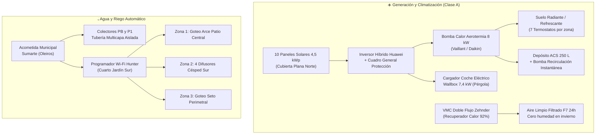

# Proyecto Técnico de Ejecución y Memoria de Calidades
**Vivienda Unifamiliar "Pabellón con Patio de Luz" (Opción C Optimizada — 212 m²)**  
**Emplazamiento:** Liáns / Santa Cruz, Concello de Oleiros (A Coruña)

> [!IMPORTANT]
> Este documento constituye la guía técnica de referencia para solicitar ofertas comparables ("a precio cerrado") a empresas constructoras de la comarca de A Coruña, evitando indefiniciones o sobrecostes durante la obra.

---

## 1. Solución a Exteriores: Barbacoa y Herramientas de Jardín

### 🔥 1.1. Cocina de Verano y Barbacoa Cubierta (Extremo Este del Porche Sur)
* **Ubicación estratégica:** Adosada al muro lateral Este del porche cubierto Sur, a solo **3,00 metros lineales de la isla de la cocina interior** y frente a la mesa de comedor exterior.
* **Protección climática (Viento Nordés y lluvia):** El propio muro lateral Este hace de pantalla cortavientos frente al Nordés de verano y el alero de 2,20 m permite usarla aunque llueva.
* **Equipamiento técnico incluido:**
  * Bancada de **2,40 × 0,65 m** en **Granito Negro Zimbabwe abujardado/cepillado** (inurne a manchas de grasa e intemperie).
  * **Barbacoa de Obra para Carbón y Brasas (Churrasqueira Contemporánea):** Cámara de combustión revestida en **ladrillo refractario de alta densidad** con parrilla en V de acero inoxidable marino **AISI 316** con volante elevador lateral, canal recoge-grasas extraíble, cajón cenicero inferior y **carbonera/leñera seca ventilada** bajo la bancada de granito. Incluye **campana extractora de tiro forzado** oculta en el alero con conducto aislado de doble pared hasta cubierta para eliminar el 100 % de humos en el porche.
  * **Fregadero exterior** de acero inoxidable con grifo monomando (toma de Agua Fría + Agua Caliente Sanitaria), toma de desagüe sifónico, dos enchufes estancos **IP66** y nicho inferior para nevera de bebidas exterior.

### 🌿 1.2. Almacenaje de Herramientas de Jardín y Robot Cortacésped (Doble Zona)
Para evitar meter barro o restos de césped en el interior de la vivienda o rayar los coches con bicicletas y rastrillos, se proyectan **dos espacios independientes**:
1. **Armario / Cuarto de Jardinería Sur (3,5 m² — Extremo Oeste del Porche):**
   * Oculto e integrado tras un revestimiento de listones verticales de madera termotratada en el lateral Oeste del porche, con apertura directa al césped Sur.
   * **Garaje inferior para el Robot Cortacésped (tipo Husqvarna Automower):** Dispone de compuerta inferior automática para que el robot salga a cortar el césped solo y vuelva a su base de carga bajo techo.
   * **Equipamiento interior:** Toma de corriente 16A (cargador de baterías de cortabordes/soplador), colgadores murales para palas, rastrillos, tijeras de poda, estantería para abonos/fitosanitarios, arcón para los cojines del porche y **centralita + colector de electroválvulas del riego automático**.
2. **Trastero Norte junto a Pérgola (8,1 m² — Acceso desde Pérgola y Pasillo Oeste):**
   * Destinado a equipamiento deportivo limpio de la familia (4 bicicletas, tablas de surf, neoprenos con barra de secado), hidrolimpiadora (junto a toma de agua Norte) y cuarto técnico interior (Aerotermia, VMC y Rack de Comunicaciones).

---

## 2. Dotación Eléctrica, Iluminación y Red RJ45 por Estancia

> [!TIP]
> Todo el cableado de red de datos (**Categoría 6A S/FTP blindado de hasta 10 Gbps**) discurre **100 % empotrado por el interior de los tabiques** bajo tubo corrugado de Ø25 mm independiente del tubo eléctrico (evitando interferencias electromagnéticas), convergiendo en el **Armario Rack del Cuarto Técnico**.

| Estancia | Enchufes 16A | Cargadores USB-C (en pared) | Tomas Dobles Red RJ45 (Cat 6A) | Puntos de Luz y Conmutación |
| :--- | :---: | :---: | :---: | :--- |
| **Salón - Comedor (46,2 m²)** | 10 ud. | 2 ud. (junto a sofá) | **2 tomas dobles** (4 puertos RJ45 tras TV para SmartTV, consola, decodificador y barra sonido) | Foseado perimetral tira LED 2700K regulable + 6 focos empotrados antideslumbramiento + 2 lámparas suspendidas sobre mesa comedor. **1 Punto Acceso Wi-Fi 7 PoE en techo.** |
| **Cocina con Isla (16,5 m²)** | 12 ud. *(6 de fuerza + 4 en encimera + 2 ocultos en isla)* | 2 ud. (en lateral de la isla) | **1 toma doble** (para pantalla/tablet de cocina o portátil en barra) | Carril magnético empotrado sobre isla + tira LED bajo muebles altos + iluminación interior en vitrinas. |
| **Patio Central (17,0 m²)** | 2 ud. (IP66 estancos) | — | — | 3 proyectores de suelo IP67 bañando el Arce Japonés + tira LED oculta perimetral. |
| **Despacho / Suite Visitas PB (10,5 m²)** | 6 ud. | 2 ud. (en mesillas/escritorio) | **2 tomas dobles** (1 en mesa de teletrabajo + 1 en pared de TV) | Luz general + 2 apliques de lectura en cabecero con triple conmutación. |
| **Dormitorio Niña (14,6 m² - P1)** | 6 ud. | 2 ud. (1 en mesilla + 1 en escritorio) | **2 tomas dobles** (1 bajo el escritorio de estudio + 1 frente a la cama para TV/consola) | Luz central + foseado LED cabecero + aplique lectura + luz interior de armario por sensor. |
| **Dormitorio Niño (14,6 m² - P1)** | 6 ud. | 2 ud. (1 en mesilla + 1 en escritorio) | **2 tomas dobles** (1 bajo el escritorio de estudio + 1 frente a la cama para TV/consola) | Idéntica dotación al dormitorio de la niña. |
| **Suite Matrimonio + Vestidor (31,2 m² - P1)** | 8 ud. | 2 ud. (uno en cada mesilla) | **2 tomas dobles** (1 en pared frente a cama + 1 en tocador/mesilla) | Foseado cálido en cabecero + apliques de lectura + tiras LED integradas en barras de vestidor. |
| **Galería Estudio P1 (7,8 m²)** | 3 ud. | 1 ud. | **1 toma doble** + **1 Punto Acceso Wi-Fi 7 PoE en techo** | Balizas de cortesía nocturna a 30 cm del suelo con detector de presencia (para cuando los niños van al baño de noche). |
| **Baños (×3)** | 2 ud. c/u (junto a lavabo) | — | — | Focos IP54 en zona ducha + retroiluminación LED antivaho en espejos. |
| **Porche Sur + Barbacoa + Jardín** | 5 ud. (IP66 estancos) | — | **1 Punto Acceso Wi-Fi Exterior IP65** en techo de porche | Focos cálidos 2700K en techo porche + luz técnica sobre parrilla barbacoa + 8 balizas en jardín con reloj astronómico. |
| **Pérgola + Cuarto Técnico** | 4 ud. + **Wallbox 32A** | — | **Armario Rack Central 6U** (Router Fibra + Switch PoE 16 puertos) | Plafones LED con sensor de movimiento al aparcar los coches. |

---

## 3. Esquema Técnico de Instalaciones

---

## 4. Memoria Detallada de Calidades y Electrodomésticos

### 4.1. Cocina con Isla y Lavandería (Todo incluido en presupuesto)
* **Mobiliario de Cocina:** Diseño a medida tipo **Santos** (serie *Fine*, fabricada en Galicia), frentes con tratamiento antihuellas en laca mate seda combinados con columnas en laminado madera roble humo. Cajones de extracción total con freno *Blum Legrabox* e iluminación LED interior automática.
* **Encimera e Isla (3,00 × 1,05 m):** Superficie ultracompacta **Dekton de Cosentino** (grosor 20 mm) en bancada, isla y frontal salpicadero (soporta ollas hirviendo directamente y no se mancha con limón, vino ni aceite).
* **Lote de Electrodomésticos Integrados de Gama Media-Alta (Bosch Serie 8 / Siemens iQ700):**
  1. **Placa de Inducción con Extractor Integrado:** *Bora Pure* o *Bosch Serie 8* de 80 cm (absorbe el vapor y el olor hacia abajo en la propia isla, dejando el techo totalmente limpio frente al patio acristalado).
  2. **Frigorífico XXL Integrable (Columna 1):** 177,5 × 56 cm todo refrigerador con cajones *VitaFresh 0°C*.
  3. **Congelador Vertical Integrable (Columna 2):** 177,5 × 56 cm No-Frost (capacidad total combinada > 520 litros para familia de 4 + invitados).
  4. **Horno Pirolítico Multifunción con Vapor (Columna 3):** *Bosch Serie 8* con sonda térmica y autolimpieza pirolítica.
  5. **Microondas Integrable sin marco (Columna 3):** 25 litros en cristal negro coordinado con el horno.
  6. **Lavavajillas Totalmente Integrado:** 60 cm, tercera bandeja para cubiertos, apertura automática de puerta al finalizar para secado eficiente (*EfficientDry*).
  7. **Lavandería (Cuarto independiente):** Lavadora 9 kg 1400 rpm (*Bosch Serie 6 i-DOS* con dosificación automática de detergente) + Secadora por Bomba de Calor 9 kg A+++ montadas en columna.

### 4.2. Cerramientos, Vidrios y Oscurecimiento
* **Carpintería de Aluminio:** Serie minimalista **Cortizo Cor Vision Plus** en las grandes correderas del Salón Sur y el Patio Central (perfiles empotrados en el suelo para no tropezar al salir al porche o al patio) y **Cortizo COR 80 Industrial RPT** oscilobatiente en dormitorios y baños.
* **Acristalamiento:** Triple vidrio laminado de seguridad con doble cámara de gas Argón (`4+4 Silence / 16 Ar / 4 / 16 Ar / 4+4 Guardian Sun`), garantizando aislamiento térmico en invierno, control solar en verano y aislamiento acústico de 42 dB.
* **Oscurecimiento:** En los 4 dormitorios, cajón oculto con **persianas autoblocantes motorizadas** de aluminio perfilado o estores enrollables motorizados ocultos en cortinero.

### 4.3. Riego Automático y Jardinería Exterior
* **Tomas de agua exteriores:** 3 bocas de riego manual con grifo de cuarto de vuelta (1 en Pérgola Norte para lavar coches/tablas de surf, 1 en el Patio Central y 1 en el Jardín Sur).
* **Riego Automático Inteligente:** Centralita **Hunter Hydrawise Wi-Fi** conectada por internet a la estación meteorológica de A Coruña/Oleiros (suspende automáticamente el riego los días que llueve).
  * **Sector 1 (Patio Central):** Tubería de goteo autocompensante enterrada bajo corteza/grava blanca para el Arce Japonés y helechos.
  * **Sector 2 (Pradera Césped Sur):** Toberas rotativas *Hunter MP Rotator* emergentes (quedan ocultas bajo el césped cuando no funcionan y ahorran un 30 % de agua evitando que el viento desvíe el chorro).
  * **Sector 3 (Cierre Vegetal Perimetral):** Línea de goteo para el seto perimetral (fotinias / laurel real / bambú no invasivo) que da intimidad al jardín.
